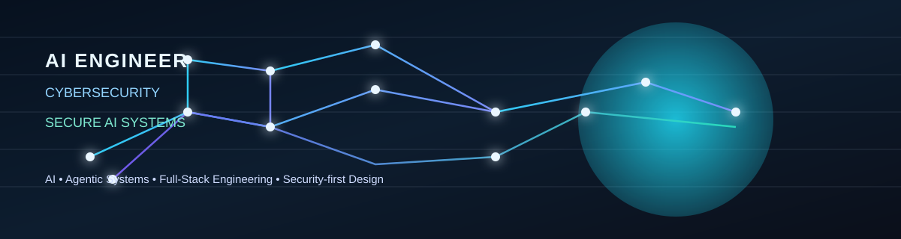

  

  
  
  
  

<h1 align="center">AI Engineer × Cybersecurity Engineer</h1>

  <strong>Building secure AI systems, agentic tooling, and practical software products.</strong>

  

---

## About

I build systems at the intersection of AI, software engineering, and security.

My work focuses on:
- AI-enabled product design
- Agentic workflows and developer tooling
- Real-time full-stack systems
- Secure-by-design architecture
- Cybersecurity fundamentals and applied security thinking
- Practical engineering with a bias toward clarity, reliability, and trust

I care about building tools that are useful, verifiable, and secure — not just impressive on paper.

---

## Core Focus

### AI & Agentic Systems
- Agentic AI workflows
- AI-assisted tooling
- Repository-aware automation
- LLM-oriented workflows
- Automation and decision support systems

### Cybersecurity
- Security fundamentals
- Secure software engineering
- Threat-aware design
- Defensive thinking
- Trusted and safe AI systems

### Software Engineering
- TypeScript / JavaScript
- Python
- Node.js / Express
- Next.js / React
- Supabase
- Socket.IO
- Rust tooling
- Full-stack product development

---

## Featured Work

### TConnect
Real-time social and multiplayer room experience built with Next.js, React, Express, Socket.IO, and Supabase.

- Real-time room creation and joining
- Multiplayer flow orchestration
- Authentication and session handling
- Event-driven backend architecture
- Full-stack product iteration

Repository:
- https://github.com/twintestr/tconnect

Status:
- Actively developed / functional prototype

---

### repository-harness
A repository-level harness for AI coding agents and human + AI collaboration.

- Agent-aware repository structure
- Context-first engineering workflows
- Tooling for AI-assisted development
- Rust-based CLI infrastructure
- Better repository readiness and operational clarity

Repository:
- https://github.com/twintestr/repository-harness

Status:
- Actively developed tooling project

---

### 90DaysOfCyberSecurity
A structured cybersecurity learning roadmap focused on building real security fundamentals.

- Linux and systems understanding
- Networking and security concepts
- Python and security tooling
- Learning path for offensive/defensive foundations

Repository:
- https://github.com/twintestr/90DaysOfCyberSecurity

Status:
- Continuous learning / study project

---

### Blockchain-For-Intellectual-Property-Rights-Protection
A blockchain-oriented project focused on digital ownership, trust, and traceability.

Repository:
- https://github.com/twintestr/Blockchain-For-Intellectual-Property-Rights-Protection

Focus:
- Intellectual property protection
- Secure ownership tracking
- Trust-aware digital systems
- Applied blockchain thinking

Status:
- Concept-to-application exploration

---

## Engineering Approach

I prefer systems that are:
- practical before flashy
- secure by default
- observable and understandable
- product-oriented rather than theoretical
- designed for iteration

My workflow generally follows:
1. Understand the problem
2. Design the architecture
3. Build a working proof of concept
4. Validate behavior
5. Refine with security and reliability in mind

---

## Current Focus

- Secure AI systems
- Agentic AI workflows
- AI-driven tooling for engineering teams
- Full-stack product engineering
- Applied cybersecurity
- Responsible, trustworthy technology

---

## Tech Stack

### Languages
- TypeScript
- JavaScript
- Python
- Rust
- SQL

### Frontend
- Next.js
- React
- Real-time interfaces
- UI implementation

### Backend
- Node.js
- Express
- Socket.IO
- REST / event-driven development
- Supabase

### AI / Agentic
- AI-assisted workflows
- Agent infrastructure
- Tooling for coding agents
- Workflow automation

### Security
- Cybersecurity fundamentals
- Secure systems mindset
- Threat-aware architecture
- Secure software practices

---

## Open to Collaboration

I’m open to:
- AI engineering collaborations
- Secure AI and trustworthy AI projects
- Full-stack product development
- Agentic tooling and AI productivity systems
- Cybersecurity-focused engineering work
- Technical experiments with real-world value

---

## Contact

- GitHub: https://github.com/twintestr
- Repositories: https://github.com/twintestr?tab=repositories

---

  <em>Building systems where AI, software engineering, and security meet.</em>

